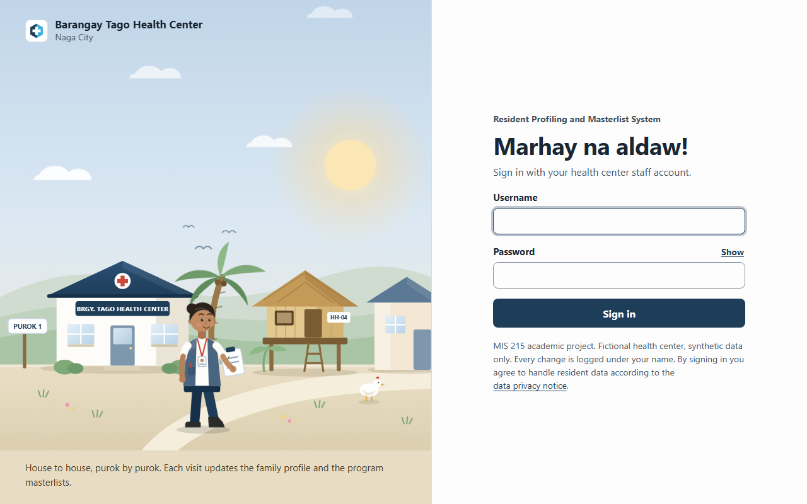
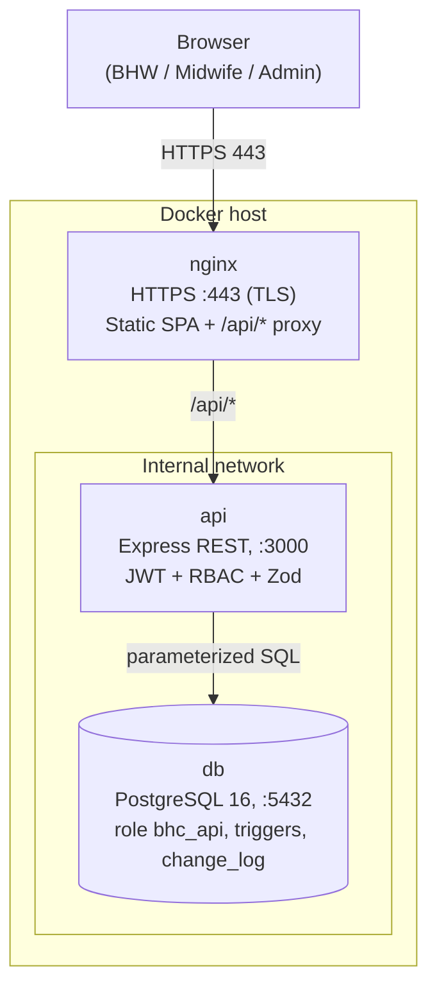

# Barangay Health Center Resident Profiling and Masterlist System

A three-tier web system that replaces paper forms and spreadsheets for resident profiling and masterlists at the fictional **Barangay Tago Health Center, Naga City, Camarines Sur**.

Academic project for **MIS 215: Client-Server Computing**, Bicol University Graduate School.

> **Synthetic data only.** Every record in this repository is fictional. It contains no real resident, patient, or health data. Never load real resident data into it.



## Contents

1. [Features](#1-features)
2. [Architecture](#2-architecture)
3. [Demo accounts and roles](#3-demo-accounts-and-roles)
4. [Quick start (Docker)](#4-quick-start-docker)
5. [Configuration](#5-configuration)
6. [Local development](#6-local-development)
7. [API overview](#7-api-overview)
8. [Testing](#8-testing)
9. [Backup and restore](#9-backup-and-restore)
10. [Security and privacy](#10-security-and-privacy)
11. [Troubleshooting](#11-troubleshooting)
12. [Project layout and documentation](#12-project-layout-and-documentation)
13. [License](#13-license)

---

## 1. Features

- **Household encoding wizard** that follows the DOH Household Profiling Form.
- **Resident directory** with search, filters, and family grouping (`group_by=household`).
- **Masterlists** for maternal, pediatric, senior, and PWD residents, computed by the database and print-friendly.
- **Role-based access** (BHW, Midwife, Admin) enforced by the API on every request, with purok (zone) scoping for BHWs.
- **No deletes.** Residents, households, and users are deactivated, never removed.
- **Archive and restore.** Deactivated residents appear in the Archive tab with who archived them, when, and why. BHWs can restore residents in their own puroks.
- **Audit trail.** Database triggers stamp `created_by` / `updated_by` and write every change to `change_log`. Each resident has a change history view.
- **Account security.** bcrypt password hashing, server-side sessions, and self-service password change.

## 2. Architecture

| Tier | Folder | Technology | Exposure |
| :--- | :--- | :--- | :--- |
| 1. Presentation | `web/`, `nginx/` | React 18, Vite, Tailwind CSS, React Router, served by nginx | HTTPS on port **443** (the only published port) |
| 2. Application | `api/` | Node.js 20+, Express, Zod, JWT, bcryptjs, helmet, express-rate-limit | Internal, port 3000 |
| 3. Data | `database/` | PostgreSQL 16 | Internal, port 5432 |

Docker Compose runs three containers: `nginx`, `api`, and `db`. The browser never talks to the database.



How the tiers behave:

- **nginx** serves the built SPA and proxies `/api/*` to the API.
- **api** validates input with Zod, checks role and purok scope, then runs SQL through `withTransaction()`, which sets `app.current_user_id` so triggers can stamp the audit columns.
- **db** connects the API as `bhc_api`, a least-privilege role with no DDL rights. Constraints enforce demographic validation, and the `masterlist(category)` function builds the masterlists.

## 3. Demo accounts and roles

The seed script creates these synthetic accounts. Password for all of them: `Demo#12345`

| Username | Role | Zones | What it can do |
| :--- | :--- | :--- | :--- |
| `admin1` | ADMIN | System-wide | Manages user accounts and zone assignments. **No access to resident health data.** |
| `midwife1` | MIDWIFE | Puroks 1, 2, 3 | Read-only. Views residents, masterlists, the archive, and change history. Cannot create, edit, deactivate, or restore. |
| `bhw1` | BHW | Purok 1 | Creates, reads, updates, deactivates, and restores residents in Purok 1. Records in other zones return `404`. |
| `bhw2` | BHW | Puroks 2 and 3 | Same as `bhw1`, for Puroks 2 and 3. |

Every role can change **its own password** from the account menu (top right) > **Change password** (`POST /api/auth/password`). The current password is required and the user's other sessions are signed out. Only `admin1` can change a username, role, zones, or active status.

> Change these passwords before using the system anywhere other than a local demo.

## 4. Quick start (Docker)

**Prerequisites:** [Docker Desktop](https://www.docker.com/) (WSL2 backend on Windows), `openssl` for the certificate script (included with Git for Windows / Git Bash), and [Git](https://git-scm.com/). Node.js 20+ is only needed to run tests or develop locally.

1. **Create your environment file** and replace every placeholder value (see [Configuration](#5-configuration)):

   ```bash
   cp .env.example .env
   ```

2. **Generate a self-signed HTTPS certificate** into `certs/` (run in Git Bash or any POSIX shell):

   ```bash
   sh scripts/gen-cert.sh
   ```

3. **Build and start the full stack:**

   ```bash
   docker compose --profile app up --build -d
   ```

4. **Open https://localhost**, accept the self-signed certificate warning, and sign in with a [demo account](#3-demo-accounts-and-roles).

5. **Stop the stack:**

   ```bash
   docker compose --profile app down
   ```

   To wipe the database volume and re-run the SQL files (schema, role, seed):

   ```bash
   docker compose --profile app down -v
   ```

The SQL files in `database/` run **only on the first start of an empty volume**. After editing them, wipe the volume with `down -v`.

## 5. Configuration

Settings live in `.env` (copied from `.env.example`). Never commit `.env` or `certs/`.

| Variable | Purpose |
| :--- | :--- |
| `POSTGRES_DB` | Database name |
| `POSTGRES_USER` | Database owner account (used only to initialize the database) |
| `POSTGRES_PASSWORD` | Password for the owner account |
| `BHC_API_PASSWORD` | Password for the least-privilege `bhc_api` role the API uses |
| `JWT_SECRET` | Long random string used to sign tokens, for example `openssl rand -hex 32`. Required in production. |
| `SESSION_HOURS` | Session lifetime in hours (default `8`) |

In production mode the API refuses to start without `JWT_SECRET` and `DATABASE_URL`. Docker Compose builds `DATABASE_URL` for you from the variables above.

## 6. Local development

Run the tiers on your machine with only the database in Docker:

```bash
# 1. Database only (runs database/*.sql on first start)
docker compose up -d db

# 2. API on http://localhost:3000
cd api
npm install
npm start

# 3. Web dev server on http://localhost:5173
cd ../web
npm install
npm run dev
```

Open a `psql` shell in the database container:

```bash
docker compose exec db psql -U "$POSTGRES_USER" -d "$POSTGRES_DB"
```

If you need a schema change, add `database/migrations/NNN_description.sql` and update the docs. Do not invent tables or columns outside the schema.

## 7. API overview

The REST API speaks JSON and has 14 operations. The full contract, with schemas and error shapes, is [`docs/openapi.yaml`](docs/openapi.yaml). If behavior changes, update that file in the same change.

| Area | Endpoints |
| :--- | :--- |
| Auth | `POST /api/auth/login`, `POST /api/auth/logout`, `POST /api/auth/password` |
| Households | `GET/POST /api/households`, `GET/PATCH /api/households/{id}` |
| Residents | `GET/POST /api/residents`, `GET/PATCH /api/residents/{id}`, `POST /api/residents/{id}/reactivate`, `GET /api/residents/{id}/history` |
| Masterlists | `GET /api/masterlists` |
| Users (admin) | `GET/POST /api/users`, `GET/PATCH /api/users/{id}` |

See `docs/openapi.yaml` for exact methods and status codes. Conventions for errors, validation, and transactions are in [`docs/CONVENTIONS.md`](docs/CONVENTIONS.md).

## 8. Testing

### 8.1 API tests (Node.js test runner and supertest)

Needs the database running (`docker compose up -d db`).

```bash
npm --prefix api test
```

The suite covers every endpoint with success and failure cases (400, 401, 403, 404), role and zone rules, error mapping, and transaction integrity. The test files share one database, so they run one at a time (`--test-concurrency=1`).

Current status: **93 tests passing** across 11 files in `api/test/`.

### 8.2 Bruno collection (`tests/bruno/`)

```bash
bru run tests/bruno --env Local             # local API
bru run tests/bruno --env Docker --insecure # Docker HTTPS stack
```

See [`tests/bruno/README.md`](tests/bruno/README.md) for details and the graphical setup.

### 8.3 Load testing (`tests/load/`)

```bash
npm --prefix api run load-test                              # built-in Node.js runner
k6 run tests/load/k6-script.js                              # Grafana k6
locust -f tests/load/locustfile.py --host http://localhost:3000   # Locust
```

Result: **700+ requests/s with 0.00% errors at 50 concurrent virtual users.** Method, tables, and the comparison with paper and two-tier systems are in [`docs/LOAD_TEST.md`](docs/LOAD_TEST.md).

## 9. Backup and restore

Scripts use `pg_dump` and `psql` and write timestamped snapshots to `backups/`.

```bash
# Back up
sh scripts/backup.sh          # Linux / macOS / Git Bash
.\scripts\backup.ps1          # Windows PowerShell

# Restore
sh scripts/restore.sh backups/bhc_backup_YYYYMMDD_HHMMSS.sql
.\scripts\restore.ps1 -BackupFile backups\bhc_backup_YYYYMMDD_HHMMSS.sql
```

A verified recovery run is recorded in [`docs/BACKUP_RECORD.md`](docs/BACKUP_RECORD.md).

## 10. Security and privacy

- HTTPS only, with port 443 as the sole published port. The API and database are reachable only on the internal Docker network.
- The API connects as `bhc_api` (least privilege), never as the database owner.
- All SQL is parameterized (`pg`, no ORM, no string-built SQL). Input is validated with Zod.
- Passwords are hashed with bcrypt. Passwords, tokens, and hashes are never logged.
- Raw database errors are never returned to clients, because they can contain resident data. Errors are mapped to a fixed shape.
- Login is rate limited, and `helmet` sets security headers.
- ADMIN accounts cannot read resident health data. BHWs are limited to their assigned puroks.

Data handling and the RA 10173 (Data Privacy Act) notes are in [`docs/PRIVACY.md`](docs/PRIVACY.md).

**Out of scope:** offline entry, SMS, integration with government systems, clinical records, and real deployment.

## 11. Troubleshooting

| Symptom | Likely cause and fix |
| :--- | :--- |
| Browser warns about the certificate | Expected with the self-signed certificate. Accept it for `localhost`. |
| nginx container exits or restarts | `certs/server.crt` and `certs/server.key` are missing. Run `sh scripts/gen-cert.sh`. |
| `.env` changes or SQL edits have no effect | The database was already initialized. Run `docker compose --profile app down -v` to recreate it. |
| API cannot connect to the database | Check that `BHC_API_PASSWORD` in `.env` matches the one used when the volume was first created. Recreate the volume if you changed it. |
| API exits at startup in production | `JWT_SECRET` or `DATABASE_URL` is not set. |
| Port 443 already in use | Stop the other service using it (IIS, another web server, another Docker stack). |
| API tests fail with connection errors | Start the database first: `docker compose up -d db`. |
| Too many login attempts | The login rate limiter is active. Wait and retry. |

## 12. Project layout and documentation

```
bhc-system/
├── api/                  Tier 2: Express REST API (src/, test/)
├── web/                  Tier 1: React + Vite single-page app
├── nginx/                Tier 1: reverse proxy config and Dockerfile
├── database/             Tier 3: 01_schema.sql, 02_api_role.sql, 03_demo_seed.sql,
│                         04_set_api_password.sh, migrations/
├── docs/                 Specification and project documents (below)
├── scripts/              gen-cert, backup, restore (.sh and .ps1)
├── tests/                bruno/ (API collection) and load/ (k6, Locust, Node runner)
├── docker-compose.yml    nginx, api, db
└── LICENSE               MIT
```

| Document | Contents |
| :--- | :--- |
| [`docs/openapi.yaml`](docs/openapi.yaml) | API contract |
| [`docs/CONVENTIONS.md`](docs/CONVENTIONS.md) | API, database, and security conventions |
| [`docs/DATA_DICTIONARY.md`](docs/DATA_DICTIONARY.md) | ER diagram and data dictionary |
| [`docs/PRIVACY.md`](docs/PRIVACY.md) | Data privacy statement |
| [`docs/LOAD_TEST.md`](docs/LOAD_TEST.md) | Load test report and architecture comparison |
| [`docs/BACKUP_RECORD.md`](docs/BACKUP_RECORD.md) | Backup and restore verification |

## 13. License

Released under the [MIT License](LICENSE). Developed for MIS 215: Client-Server Computing, Bicol University Graduate School.
