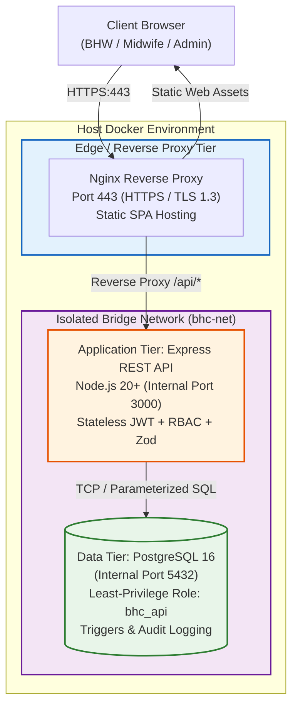

# Barangay Health Center Resident Profiling and Masterlist System

Academic project for **MIS 215: Client-Server Computing**, Bicol University Graduate School.  
Designed for the fictional **Barangay Tago Health Center, Naga City, Camarines Sur**.

> **SYNTHETIC DATA NOTICE**: This system is built strictly for academic research and evaluation using synthetic (fictional) data. It contains no real personal health data, patient charts, or identifiable resident information.

---

## 1. System Overview & Architecture

The system is a production-grade **Three-Tier Client-Server Architecture** designed to transition community health operations from manual paper forms and unversioned spreadsheets into an integrated, secure, and auditable client-server platform.

### Architecture Diagram



### Architectural Tiers

1. **Presentation Tier (`web/`)**:
   - Single Page Application (SPA) built with React 18, Vite, and Tailwind CSS.
   - Served securely over TLS/HTTPS by Nginx.
   - Household encoding wizard mirroring the official DOH Household Profiling Form.
   - Real-time resident directory with family grouping (`group_by=household`) and print-friendly masterlists.
2. **Application Tier (`api/`)**:
   - Express REST API running on Node.js 20+ (internal port 3000; never exposed directly to the internet).
   - Role-Based Access Control (RBAC) and Purok/Zone-scoping middleware.
   - Security hardening via `helmet`, rate limiting (`express-rate-limit`), and input schema validation via `zod`.
   - Strict transaction handling via `withTransaction()` setting `app.current_user_id` for immutable audit stamping.
3. **Data Tier (`database/`)**:
   - PostgreSQL 16 relational database (internal port 5432).
   - Principle of Least Privilege: The API connects as `bhc_api`, an unprivileged user without DDL rights.
   - Referential integrity, unique constraints, and check constraints enforce demographic validation.
   - High-performance stored procedure `masterlist(category)` computes real-time maternal, pediatric, senior, and PWD masterlists.
   - Soft-deactivation triggers prevent permanent record loss; all modifications are logged to `change_log`.

---

## 2. Synthetic Demo Accounts

The database comes pre-seeded with synthetic test accounts demonstrating the role-based access control policies:

| Username | Role | Purok (Zone) Scope | Permissions / Capabilities |
| :--- | :--- | :--- | :--- |
| `admin1` | **ADMIN** | System-wide | Manages user accounts and zone assignments. **Strictly barred from accessing resident health profiles or masterlists.** |
| `midwife1` | **MIDWIFE** | All Puroks (1, 2, 3) | **Read-Only Oversight.** Views resident directory and generates masterlists across all zones. Cannot create, edit, or deactivate records. |
| `bhw1` | **BHW** | Purok 1 | Encodes households, updates profiles, and views masterlists **strictly in Purok 1**. Records in other zones return `404 Not Found`. |
| `bhw2` | **BHW** | Puroks 2 & 3 | Encodes households, updates profiles, and views masterlists in **Purok 2 and Purok 3**. |

**Default Password (All Accounts)**: `Demo#12345`

---

## 3. Quick Start (Docker Compose)

### Prerequisites
- [Docker Desktop](https://www.docker.com/) (WSL2 backend recommended on Windows)
- [Node.js](https://nodejs.org/) v20+ (optional, for local tests)
- [Git](https://git-scm.com/)

### Step-by-Step Setup

1. **Clone the repository and prepare environment secrets**:
   ```bash
   cp .env.example .env
   # Edit .env to set your desired passwords and secrets
   ```

2. **Generate self-signed SSL/TLS certificates**:
   ```bash
   # On Linux/macOS/Git Bash:
   sh scripts/gen-cert.sh

   # On Windows PowerShell:
   # (Generates RSA 2048-bit server.crt and server.key in certs/)
   ```

3. **Start the complete three-tier application**:
   ```bash
   docker compose --profile app up --build -d
   ```

4. **Access the application**:
   - Open your browser to: **`https://localhost`**
   - Accept the local self-signed certificate warning in your browser.
   - Log in using one of the demo credentials above.

5. **Stop the containers**:
   ```bash
   docker compose --profile app down
   # To wipe database volumes and re-seed clean data:
   docker compose down -v
   ```

---

## 4. Local Development (Without Docker)

You can also run individual tiers locally during development:

```bash
# 1. Start the PostgreSQL database
docker compose up -d db

# 2. Start the API service (from the api/ directory)
cd api
npm install
npm start          # Runs Express on http://localhost:3000

# 3. Start the React development server (from the web/ directory)
cd ../web
npm install
npm run dev        # Runs Vite on http://localhost:5173
```

---

## 5. Automated Testing Suite

The repository includes extensive automated test suites ensuring full compliance with `docs/openapi.yaml` and the course security rules.

### 5.1 API Test Suite (Node.js Native Test Runner)
Covers all 11 endpoints, role-based zoning, error mapping, and transaction integrity:

```bash
npm --prefix api test
```
*Current status: **71/71 tests passing** across 8 test suites.*

### 5.2 Bruno API Collection (`tests/bruno/`)
A complete Bruno collection covering all 11 endpoints with success (200/201) and error cases (400, 401, 403, 404):

```bash
# Run via Bruno CLI against the local environment:
bru run tests/bruno --env Local

# Or against the Docker HTTPS stack:
bru run tests/bruno --env Docker --insecure
```
See [`tests/bruno/README.md`](tests/bruno/README.md) for full instructions and graphical UI setup.

### 5.3 Load and Stress Testing (`tests/load/`)
Includes tests simulating concurrent virtual health workers querying resident profiles and masterlists:

```bash
# Execute native high-performance Node.js benchmark:
npm --prefix api run load-test

# Or run using Grafana k6:
k6 run tests/load/k6-script.js

# Or run using Python Locust:
locust -f tests/load/locustfile.py --host http://localhost:3000
```
Empirical results (**700+ req/s, 0.00% error rate under 50 concurrent VUs**) and the full academic client-server comparison are documented in [`docs/LOAD_TEST.md`](docs/LOAD_TEST.md).

---

## 6. Backup & Disaster Recovery

The system includes automated backup and point-in-time restoration scripts utilizing `pg_dump` and `psql`:

```bash
# Create an atomic timestamped database snapshot in backups/
sh scripts/backup.sh        # Linux / macOS / Git Bash
.\scripts\backup.ps1        # Windows PowerShell

# Restore database snapshot:
sh scripts/restore.sh backups/bhc_backup_YYYYMMDD_HHMMSS.sql
.\scripts\restore.ps1 -BackupFile backups\bhc_backup_YYYYMMDD_HHMMSS.sql
```
Verified recovery records are detailed in [`docs/BACKUP_RECORD.md`](docs/BACKUP_RECORD.md).

---

## 7. Directory Structure

```
bhc-system/
├── api/                     # Tier 2: Express REST API (Node.js 20+)
│   ├── src/                 # Application source (routes, schemas, middleware)
│   ├── test/                # Automated API test suites (71 tests)
│   └── package.json
├── database/                # Tier 3: PostgreSQL 16 schema & seed scripts
│   ├── 01_schema.sql        # Tables, views, triggers, and functions
│   ├── 02_api_role.sql      # Least-privilege 'bhc_api' role definition
│   └── 03_demo_seed.sql     # Synthetic demonstration seed data
├── docs/                    # Architectural & project documentation
│   ├── openapi.yaml         # Complete OpenAPI 3.0 API specification
│   ├── CONVENTIONS.md       # API, database, and security conventions
│   ├── BUILD_PLAN.md        # Step-by-step implementation milestones
│   ├── DATA_DICTIONARY.md   # Entity-Relationship diagram & data dictionary
│   ├── PRIVACY.md           # Data privacy statement and RA 10173 compliance
│   ├── LOAD_TEST.md         # Load test report & Architectural Comparison
│   └── BACKUP_RECORD.md     # Tested backup and restoration audit logs
├── nginx/                   # Tier 1: Nginx reverse proxy configuration & Dockerfile
├── scripts/                 # Operational scripts (gen-cert, backup, restore)
├── tests/
│   ├── bruno/               # 28 Bruno API request definitions
│   └── load/                # Load test scripts (runner.js, k6, locust)
├── web/                     # Tier 1: React 18 + Vite SPA client
├── docker-compose.yml       # Multi-container orchestration (nginx, api, db)
├── AGENTS.md                # System specification & hard project rules
└── LICENSE                  # MIT License
```

---

## 8. License

This project is open-source software licensed under the **[MIT License](LICENSE)**.
Academic project developed for **MIS 215: Client-Server Computing**, Bicol University Graduate School.
